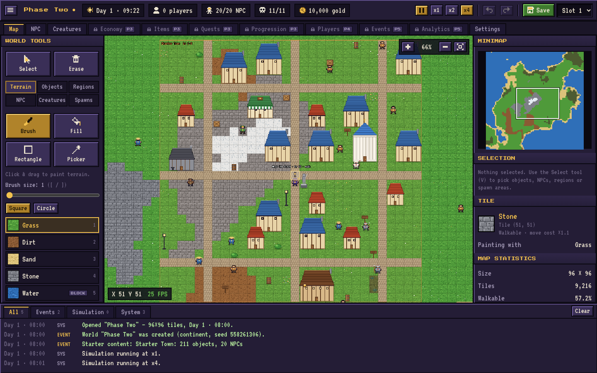
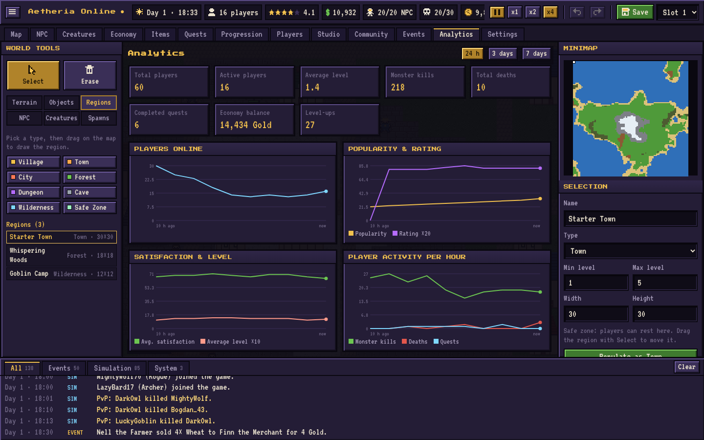
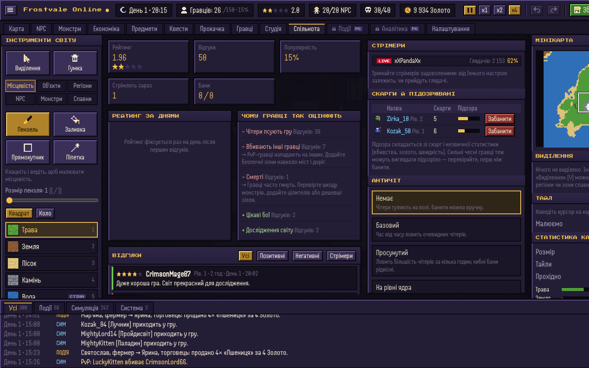
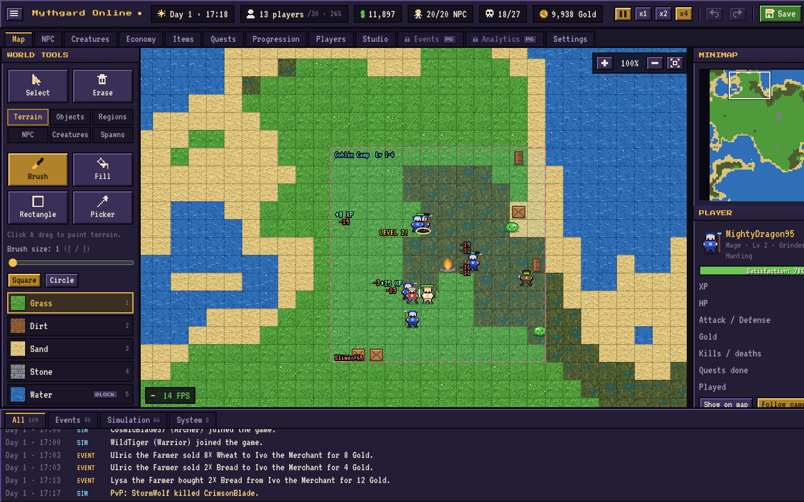
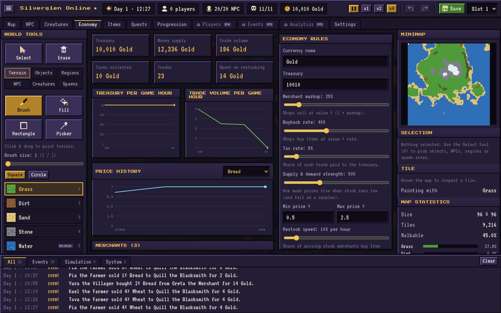

# Pixel MMORPG Tycoon

Браузерний 2D pixel-art симулятор створення власної MMORPG.
Стек: **React 18 · TypeScript · Phaser 3 · Vite · Zustand · IndexedDB**.



## Запуск

```bash
cd pixel-mmorpg-tycoon
npm install
npm run dev        # http://localhost:5173
npm test           # unit-тести (vitest)
npm run build      # production-збірка в dist/
```

## Фази

| Фаза | Зміст | Статус |
|---|---|---|
| 1. Foundation | меню, карта, редактор тайлів, камера, збереження | ✅ |
| 2. World Building | об'єкти, будівлі, регіони, NPC, монстри, спавни | ✅ |
| 3. RPG Systems | предмети, інвентар, економіка, торговці, квести, прокачка | ✅ |
| 4. Simulation | віртуальні гравці, Utility AI, бої, квести, торгівля, режими гри (сандбокс / стандарт), бюджет студії | ✅ |
| 5. Community | відгуки й рейтинг, популярність, стрімери, чітери й бани | ✅ |
| 6. Management | аналітика, події | ✅ |
| 7. Polish | оптимізація, анімації, звуки, ефекти, тести | далі |

## PHASE 6 — MANAGEMENT ✅



| Система | Що працює |
|---|---|
| Аналітика | Щогодинні знімки (тиждень гри): онлайн, популярність, рейтинг, задоволення, середній рівень, гроші, скарбниця, торгівля, фінанси студії, вбивства/смерті/квести, прихід/відтік. Лічильники за весь час. Дашборд: усього/активних гравців, середній рівень, смерті, вбиті монстри, квести, баланс економіки; 8 графіків з перемикачем 24 год / 3 дні / 7 днів; розподіл за рівнями, класами, стилями гри й заняттями; найпопулярніші локації (гравце-години), предмети й найприбутковіші торговці |
| Події | 7 типів: вторгнення монстрів, світовий бос, рідкісний торговець, подвійний досвід, фестиваль, відкриття підземелля, війна фракцій. Справжні наслідки: тимчасові монстри/бос/торговець (прибираються після завершення), множники XP, щасливіші гравці, PvP між двома фракціями; гравців притягує до подій |
| Тригери | Вручну, за розкладом (кожні N днів о певній годині), за умовою (онлайн / популярність / рейтинг / задоволення / день < або > значення), перезарядка; у стандартній грі запуск коштує $ |
| Історія подій | Учасники, вбивства, зміна популярності; індикатор активної події у верхній панелі |
| Стартові події | Подвійний досвід на вихідних (розклад), Свято врожаю (коли задоволення < 45), Набіг гоблінів (вручну), Мандрівний торговець (кожні 3 дні) |

## PHASE 5 — COMMUNITY ✅



| Система | Що працює |
|---|---|
| Відгуки | Гравці пишуть відгуки, коли кидають гру (80%) або після довгої сесії (20%): 1–5 зірок за задоволенням + текст про головну причину (по 2 варіанти фраз на кожен фактор). Тексти зберігаються як ключі — перекладаються при зміні мови |
| Рейтинг | Зважене середнє останніх 60 відгуків (новіші й стрімерські важать більше); щогодини впливає на популярність; графік за днями; «чому гравці так оцінюють» з порадами |
| Стрімери | Рідкісні гравці з глядачами (від 30 до 17 000); що популярніша гра — то частіше; задоволений стрімер приводить хвилю гравців, незадоволений — обвалює популярність; маркер LIVE над головою |
| Чітери | Спідхак (×2.5 швидкість), урон-хак (×3 шкода), дюп золота (інфляція), гріфер (вбиває навіть у безпечних зонах). Псують задоволення гравцям поруч, отримують скарги |
| Підозра | Зі скарг і аномальної статистики (вбивства/год, золото/год, PvP, швидкість); сильні чесні гравці теж отримують хибні скарги — треба перевіряти |
| Бани | Ручний бан: чітер — спільнота радіє (+популярність, фактор «Чітерів банять»); чесний гравець — обурення, 1-зірковий відгук, −популярність |
| Античіт | 4 рівні: немає / базовий / просунутий / на рівні ядра; шанс виявлення, хибні бани, вартість у стандартній грі, роздратування від ядерного |

## PHASE 4 — SIMULATION ✅



| Система | Що працює |
|---|---|
| Режими гри | **Сандбокс** — усе безкоштовно й без лімітів. **Стандартна гра** — бюджет студії ($), ціни на будівництво, утримання серверів і NPC, ліміти рівня сервера (гравці онлайн, NPC, монстри, об'єкти), дохід від підписок |
| Віртуальні гравці | 5 класів × 7 типів поведінки (Дослідник, Боєць, Гріндер, Торгаш, Мисливець за квестами, Казуал, PvP); власні рівень, XP, золото, інвентар, спорядження, квести, задоволення; зберігаються зі світом |
| Utility AI | Кожні ~15 с гравець оцінює варіанти з урахуванням HP, сумки, квестів, рівня монстрів, натовпу, золота й характеру: полювати, взяти/здати квест, продати здобич, купити зілля чи спорядження, добувати ресурси, досліджувати, відпочивати, спілкуватися, PvP |
| Бої | Стати з класу, рівня й спорядження; навички з маною й відкатом; зілля при низькому HP; монстри атакують гравців; спільний залік вбивств; смерть → респавн і втрата 10% золота |
| Квести | Гравці беруть квести в квестодавців і виконують усі 7 типів цілей; нагороди платить скарбниця світу |
| Популяція | Прихід новачків залежить від популярності (і ціни підписки), сесії різної довжини, гравці повертаються або кидають гру через головну скаргу |
| Задоволення | 18 факторів (цікаві бої, прокачка, квести… / смерті, нема контенту, тіснява, дорожнеча, PvP, нудьга, черги) |
| Вкладка «Гравці» | Онлайн / ємність, популярність, середнє задоволення, «що кажуть гравці» з порадами, графік гравці vs монстри за рівнями, таблиця, картка гравця, стеження камерою |
| Вкладка «Студія» | Кошти, дохід/витрати, підсумок дня, сервери з апгрейдом, навантаження, ціна підписки, прайс |

## Мова інтерфейсу

English / Українська — перемикач у головному меню та в налаштуваннях (за замовчуванням — мова браузера).
Ключі перекладу — англійські рядки (`t('Create New World')`), словник — `src/i18n/uk.ts`. Тест `tests/i18n.test.ts`
падає, якщо будь-який рядок у коді не має перекладу або плейсхолдери не збігаються. Для кирилиці використовується
піксельний шрифт Handjet (VT323 кирилиці не має).

## PHASE 3 — RPG SYSTEMS ✅



| Система | Що працює |
|---|---|
| Предмети | База з 40 стандартних предметів у 9 категоріях; редактор: назва, опис, піксельна іконка (40 шт.), рідкість, вартість, рівень, стати, розмір стосу, слот; «де використовується»; видалення чистить усі посилання |
| Інвентар | Стоси з урахуванням розміру стосу, обмеження комірок; інвентар і золото в кожного NPC |
| Економіка | Валюта, скарбниця, націнка, викуп, податок, множники рідкості, сила попиту/пропозиції, межі цін, швидкість поповнення |
| Торговці | Асортимент із запасом і максимумом; ціна залежить від запасу; торговці докуповують товар за власне золото |
| Жива економіка | Фермери вирощують пшеницю й несуть продавати; вартові забирають здобич із монстрів і продають; селяни купують і щодня з'їдають їжу; податок з кожної угоди йде в скарбницю. Гроші не з'являються з нізвідки (перевірено тестом) |
| Аналітика економіки | Скарбниця, грошова маса, обсяг торгівлі, податки, графіки по годинах, історія цін, таблиця торговців, журнал угод |
| Квести | Візуальний редактор: 7 типів цілей (вбити, зібрати, доставити, дослідити, поговорити, бос, добути), нагороди (XP, валюта, предмети), ланцюжки, повторюваність; **автоматична перевірка** виконуваності в поточному світі; `QuestTracker` для симуляції гравців; стартовий ланцюжок із 6 квестів |
| Прокачка | Формула XP (база × рівень^степінь) з графіком і таблицею, максимальний рівень, формули HP/мани/атаки/захисту; 5 класів (Воїн, Маг, Лучник, Пройдисвіт, Паладин) з атрибутами, ростом і навичками; прев'ю персонажа зі спорядженням |

Схема збережень v3: назви предметів зі старих світів автоматично перетворюються на посилання на базу предметів.

## PHASE 2 — WORLD BUILDING ✅

| Система | Що працює |
|---|---|
| Об'єкти | 35 типів: дерева, каміння, кущі, будинки, магазин, кузня, таверна, храм, банк, вежа, стіни, дороги, мости, декор, портали, входи в підземелля й печери. Процедурний pixel-art в одному атласі |
| Розміщення | Прев'ю-привид (червоний = не можна), малювання протягуванням для 1×1, перевірка перекриттів і води/лави; мости роблять воду прохідною |
| Виділення | Select (V): клік, Shift+клік, рамка; перетягування = переміщення; Ctrl+C / Ctrl+V (у курсор) / Ctrl+D; Delete; Erase (E); усе з undo |
| Регіони | Village, Town, City, Forest, Dungeon, Cave, Wilderness, Safe Zone з рівнями. Кнопка **Populate** генерує село, місто, мегаполіс зі стінами, ліс з вовками, підземелля зі скелетами й босом, печеру з павуками; скасовується одним Ctrl+Z |
| Spawn points | Точки появи гравців (для Phase 4) |
| NPC | 9 типів; редактор: ім'я, рівень, HP, позиція, швидкість, поведінка Stationary/Wander/Patrol з waypoints, робочі години, радіус, інвентар, магазин; таблиця з пошуком і фільтрами |
| Поведінка NPC | Ходять по A*, поза робочими годинами йдуть додому відпочивати (Zz), охоронці патрулюють і атакують монстрів, мирні NPC тікають, гинуть і відроджуються |
| Монстри | 9 типів (Slime, Goblin, Wolf, Skeleton, Orc, Spider, Zombie, Dragon, Boss), бестіарій з усіма параметрами й loot table, зони спавну з лімітом, респавн, агресія Passive/Defensive/Aggressive, переслідування з поверненням додому |
| Стартовий контент | Новий світ отримує поселення з **точною кількістю NPC із налаштувань**, ліс з вовками і табір гоблінів |
| Бої | Шкода, захист, кулдаун, плаваючі числа шкоди та XP, HP-бари, журнал вбивств |

Технічно: `EntityStore` (усі сутності + undo), `ObjectIndex`, `NavGrid` + `Pathfinder` (A* з бінарною купою й лімітом вузлів), `SpatialHash` для пошуку цілей, `ActorManager` + `NpcSystem`/`CreatureSystem` на фіксованому кроці, пул спрайтів і y-сортування в `EntityRenderer`. Збереження: схема v2 з автоматичною міграцією світів Phase 1.

## PHASE 1 — FOUNDATION ✅

| Система | Що працює |
|---|---|
| Головне меню | Continue, Create New World, My Worlds, Load World, Settings; анімований фон зі згенерованого світу |
| Створення світу | Назва, розмір (пресети 48–256 або custom 16–512), 7 типів світу, складність, стартове золото, seed, к-сть NPC/гравців; живе прев'ю карти + склад місцевості |
| Карта | Phaser tilemap 32×32, 8 типів місцевості × 4 варіанти, процедурний pixel-art тайлсет, анімація води та лави |
| Редактор тайлів | Brush (1–15, квадрат/коло, без розривів при швидкому русі), Fill, Rectangle (заливка/контур), Picker; Undo/Redo (200 кроків); зміна розміру карти з якорем; регенерація |
| Камера | WASD/стрілки (Shift = швидше), drag правою/середньою кнопкою або Space+ЛКМ, плавний zoom колесом до курсора (20–400%), Fit, мінікарта з кліком/перетягуванням |
| Симуляція (основа) | Fixed-timestep рушій (10 тіків/с), Play/Pause, x1/x2/x4, ігровий час, день/ніч з освітленням |
| Збереження | IndexedDB; Autosave + 3 ручні слоти; автозбереження за інтервалом; Ctrl+S; експорт/імпорт JSON з валідацією; rename/duplicate/delete; попередження при закритті вкладки |
| UI | Верхня панель, вкладки, ліва (інструменти/місцевість), права (мінікарта, інспектор, статистика карти), нижня (журнал з фільтрами) |

Вкладки та секції наступних фаз показані **заблокованими з позначкою фази** — вони не вдають, що працюють.
Лічильник гравців у верхній панелі чесно показує 0 до Phase 4.

## Архітектура

```
src/
  core/          EventBus, ID-генератор, seeded RNG, noise — без залежностей
  data/          Реєстри: terrain (id, палітра, walkable, moveCost), пресети світів
  models/        TileGrid (Uint8Array + RLE), типи збережень WorldSave/WorldMeta
  simulation/    WorldRuntime (живий стан світу), SimulationEngine (fixed timestep),
                 systems/ClockSystem, time (день/ніч)
  systems/
    editor/      TerrainPainter (штрихи, fill, rect), History (команди undo/redo), shapes
    generation/  WorldGenerator (elevation/moisture noise), createWorld
  persistence/   db (IndexedDB), WorldRepository (слоти), serializer (JSON, валідація, міграції)
  session/       GameSession — з'єднує runtime + engine + history + save; sessionActions
  game/          Phaser: WorldScene (рендер + ввід), CameraController, TilesetPainter
  stores/        Zustand: session, editor, settings (persist), log, toast, dialog
  ui/            screens/ (меню), editor/ (панелі редактора), components/, hooks/
tests/           TileGrid/RLE, інструменти, undo, рушій, IndexedDB, JSON
```

Потік даних:

```
React UI ──(Zustand: інструмент, налаштування)──► WorldScene (Phaser)
   ▲                                                  │ pointer → TerrainPainter
   │ події (tiles:changed, map:replaced)              ▼
   └──────────────── WorldRuntime ◄── SimulationEngine (fixed tick, власний rAF)
                          │
                    WorldRepository (IndexedDB) / JSON
```

Ключові правила:
- **Симуляція не залежить від React і Phaser** — вона змінює лише `WorldRuntime`. Рушій працює з фіксованим кроком; швидкість x2/x4 збільшує кількість тіків, а не їхній розмір (детермінізм).
- **Великі дані не живуть у React-стані**: сітка тайлів — `Uint8Array` у `WorldRuntime`; Phaser і мінікарта оновлюються інкрементально лише для змінених тайлів.
- **Усі сутності мають унікальні ID** (`core/ids.ts`).
- **Збереження версіоновані** (`schemaVersion` + `migrate()`), RLE-стиснення карти.

## Продуктивність (вже закладено)

- Tilemap rendering з culling; 1px-екструзія тайлсету (без швів при дробовому zoom).
- Grid малюється лише для видимої області.
- Анімація води/лави — перемальовування двох рядків тайлсету, а не тайлів карти.
- Fixed timestep з обмеженням тіків на кадр; `interval` у системах для розподілу важкої роботи.
- Phaser вантажиться ліниво (окремий chunk) — меню стартує швидко.

## Підготовка до PHASE 7 — POLISH

- Звуки та музика (Web Audio, процедурні 8-біт ефекти).
- Анімації: атаки, смерть, частинки, плавні переходи дня й ночі.
- Оптимізація для сотень гравців: worker для AI, батчинг рендеру, профілювання.
